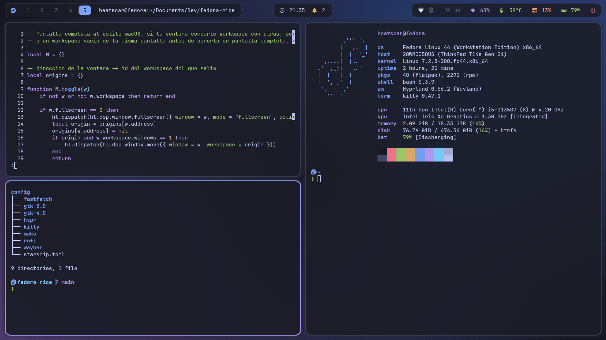
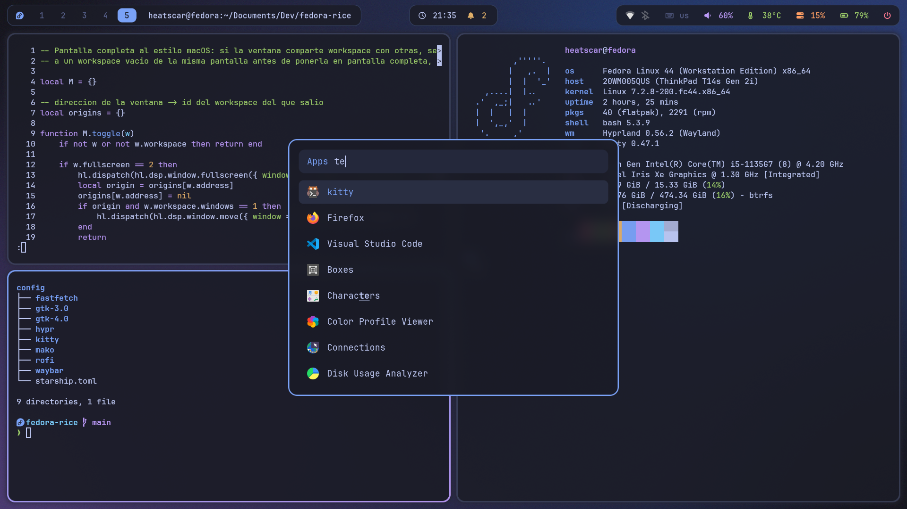
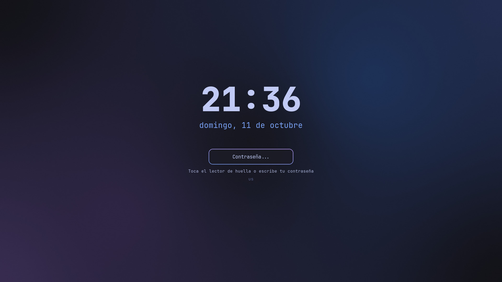

# fedora-rice

Rice de **Hyprland** con paleta **Tokyo Night** para **Fedora 44 Workstation**: mosaico automático de ventanas, barra en "islas", lanzador, notificaciones, terminal, pantalla de bloqueo y tema de apps a juego. Se instala con un solo script y convive con GNOME, que queda como sesión alternativa.



| Lanzador de apps | Pantalla de bloqueo |
|---|---|
|  |  |

## Qué incluye

| Componente | Programa |
|---|---|
| Compositor | Hyprland 0.56 (configuración en Lua) |
| Barra | Waybar |
| Lanzador, menú de energía, portapapeles | Rofi |
| Terminal | Kitty |
| Prompt | Starship |
| Notificaciones | Mako |
| Fondo de pantalla | Hyprpaper |
| Bloqueo e inactividad | Hyprlock + Hypridle |
| Luz nocturna | Hyprsunset |
| Tema de apps | adw-gtk3-dark + colores Tokyo Night para GTK3/GTK4 |
| Iconos y cursor | Papirus-Dark + Bibata-Modern-Ice |
| Fuente | JetBrainsMono Nerd Font |
| Extra | Fastfetch personalizado |

## Importante antes de instalar

**Hyprland no viene de los repos oficiales de Fedora.** Fedora 44 no lo empaqueta, así que el instalador activa el COPR comunitario [`sdegler/hyprland`](https://copr.fedorainfracloud.org/coprs/sdegler/hyprland/), que es el Hyprland original compilado para Fedora junto con su ecosistema (hyprlock, hypridle, hyprpaper, etc.). Es un repositorio de terceros: quien lo mantiene no es Fedora ni el proyecto Hyprland.

**La configuración está en Lua, no en `hyprland.conf`.** Desde las versiones recientes Hyprland se configura con `~/.config/hypr/hyprland.lua`. Casi todas las guías y dotfiles antiguos usan la sintaxis `hyprland.conf` (`bind = SUPER, Q, killactive`), que no sirve aquí. La referencia válida es la [wiki oficial](https://wiki.hypr.land/Configuring/Start/).

**Probado en:** Fedora 44 Workstation con GNOME 50, Hyprland 0.56.2, gráficos Intel Iris Xe (ThinkPad T14s Gen 2i), con un monitor externo. No está probado con NVIDIA ni en otras versiones de Fedora; el COPR debe tener paquetes para tu versión.

## Instalación

```bash
git clone https://github.com/Heatscar/fedora-rice.git
cd fedora-rice
./install.sh
```

El script hace lo siguiente:

1. Activa el COPR `sdegler/hyprland` e instala los paquetes con `dnf` (pide tu contraseña de `sudo` y confirmación).
2. Descarga en tu carpeta personal, sin `sudo`, la fuente JetBrainsMono Nerd Font, el cursor Bibata-Modern-Ice y Starship (este último verificando su suma sha256).
3. Copia las configuraciones a `~/.config`. Si ya tenías algún archivo distinto, guarda antes una copia en `~/.config/rice-backup-<fecha>/`.

Opciones:

| Comando | Efecto |
|---|---|
| `./install.sh` | Instalación completa |
| `./install.sh --no-packages` | Omite `dnf`; no pide `sudo` |
| `./install.sh --configs-only` | Solo copia las configuraciones (útil para actualizar) |

### Entrar a Hyprland

1. Cierra sesión.
2. En la pantalla de login selecciona tu usuario y abre el engranaje de abajo a la derecha.
3. Elige **Hyprland**. No elijas "Hyprland (uwsm-managed)": esta configuración está pensada para la sesión normal.
4. Inicia sesión. `Super + Enter` abre una terminal y `Super + F1` muestra los atajos.

Si algo queda inutilizable, `Super + Shift + E` abre el menú de energía. Si tampoco responde, `Ctrl + Alt + F3` da una consola de texto, y desde el login siempre puedes volver a GNOME.

## Atajos

| Atajo | Acción |
|---|---|
| `Super + Espacio` | Lanzador de apps; otra vez lo cierra |
| `Super + Enter` | Terminal (kitty) |
| `Super + E` / `Super + B` | Archivos (Nautilus) / Firefox |
| `Super + I` | Ajustes de GNOME (red, Bluetooth, sonido) |
| `Super + Q` | Cerrar ventana |
| `Super + F` / `Super + M` | Pantalla completa en un workspace propio / maximizar |
| `Super + Shift + V` | Ventana flotante |
| `Super + J` | Cambiar la orientación de la división |
| `Super + flechas` | Mover la ventana o ajustarla a media pantalla |
| `Super + Shift + flechas` | Enviar la ventana a la otra pantalla |
| `Super + Alt + flechas` | Cambiar el foco |
| `Super + Ctrl + flechas` | Redimensionar la ventana |
| `Alt + Tab` | Lista de todas las ventanas abiertas; `Enter` elige |
| `Super + clic izquierdo` / `derecho` | Arrastrar / redimensionar con el ratón |
| `Super + 1..0` | Ir al workspace |
| `Super + Shift + 1..0` | Enviar la ventana al workspace |
| `Super + Shift + N` | Enviar la ventana al primer workspace vacío de esa pantalla |
| `Super + Tab` | Volver al workspace anterior |
| `Super + rueda del ratón` | Workspace siguiente / anterior |
| `Super + V` | Historial del portapapeles |
| `Super + N` | Activar o desactivar la luz nocturna |
| `Super + L` | Bloquear |
| `Super + Shift + E` o `Ctrl + Alt + Supr` | Menú de energía (apagar, reiniciar y cerrar sesión piden confirmación con cuenta atrás de 60 s) |
| `Super + Shift + Espacio` | Alternar distribución de teclado (us / latam) |
| `Print` o `Super + Shift + S` | Captura de región |
| `Shift + Print` | Captura de pantalla completa |
| `Super + F1` | Ver la lista de atajos en pantalla |

Las teclas de volumen, micrófono y brillo muestran un indicador en pantalla, y las multimedia también funcionan. Deslizar tres dedos en horizontal sobre el touchpad cambia de workspace.

### Cómo se comportan las flechas

`Super + flechas` imita el ajuste de ventanas de GNOME sobre el mosaico (lógica en `snap.lua`):

- **Ventana sola en el workspace:** izquierda o derecha la ajusta a esa mitad de la pantalla; arriba o abajo la devuelve a ocupar todo el espacio.
- **Varias ventanas:** las flechas mueven la ventana dentro del mosaico.
- **Ventana maximizada o en pantalla completa:** se restaura antes de moverla.

Una ventana ajustada a una mitad queda flotando: si abres otra en ese workspace, la nueva ocupa toda la pantalla por debajo. Con dos o más ventanas no hace falta ajustar, el mosaico ya las reparte.

### Pantalla completa

`Super + F` funciona como en macOS (lógica en `fullscreen.lua`): si la ventana comparte workspace con otras, se lleva a un workspace vacío antes de ponerse en pantalla completa, de modo que las demás siguen visibles en el suyo. Al pulsar `Super + F` otra vez, o al cerrar la ventana, vuelves al workspace de origen. `Super + M` maximiza sin cambiar de workspace.

### Alt + Tab

Abre una lista con todas las ventanas abiertas, de cualquier workspace. Se avanza con `Alt + Tab` o con las flechas, se puede escribir para filtrar, y `Enter` enfoca la elegida. Soltar `Alt` no elige: hay que confirmar con `Enter`.

### Ratón

Las ventanas en mosaico no se arrastran por la barra de título. Mantén `Super` y arrastra con el clic izquierdo desde cualquier parte de la ventana para moverla, o con el derecho para redimensionarla.

## Adaptarlo a tu equipo

### Pantallas

La disposición vive en `~/.config/hypr/monitors.lua`, y el instalador no la sobrescribe si ya existe. Por defecto coloca todas las pantallas automáticamente en su resolución nativa. Para una disposición concreta:

1. Ejecuta `hyprctl monitors` para ver el nombre de cada pantalla (`eDP-1`, `DP-3`, `HDMI-A-1`...) y sus modos.
2. Edita `monitors.lua`; el archivo trae un ejemplo comentado de monitor externo arriba y portátil centrado debajo.
3. Guarda. Hyprland recarga la configuración al instante.

`position` son las coordenadas `"XxY"` de la esquina superior izquierda de cada pantalla, medidas en píxeles ya escalados (una pantalla de 1920x1080 a escala 1.25 ocupa 1536x864).

### Workspaces por pantalla

En un portátil, `workspaces.lua` reparte los workspaces según las pantallas conectadas, y la barra de cada pantalla muestra siempre los suyos:

- **Portátil con monitor externo:** del 1 al 5 en el externo y del 6 al 10 en el portátil.
- **Solo el portátil:** del 1 al 5 en el portátil.

Al conectar o desconectar el monitor el reparto se recalcula solo. Da por hecho que la pantalla integrada se llama `eDP-1` (cámbialo al principio del archivo si no es tu caso); en equipos de sobremesa no hace nada.

### Touchpad y ratón

En `hyprland.lua`, sección `INPUT`. Los Ajustes de GNOME no tienen efecto sobre el touchpad ni el ratón dentro de Hyprland. `natural_scroll = false` es el desplazamiento tradicional; `true` hace que el contenido siga a los dedos, como en macOS. `tap_to_click` activa el toque como clic.

### Fondo de pantalla

```bash
~/.config/hypr/scripts/wallpaper.sh ~/Pictures/tu-imagen.jpg
```

Cambia el fondo del escritorio y el de la pantalla de bloqueo al instante, y se mantiene al reiniciar. Acepta jpg, png, webp y jxl. El fondo por defecto es un degradado Tokyo Night (`~/.config/hypr/wallpaper.jpg`).

### Teclado

En `hyprland.lua`, sección `INPUT`: `kb_layout = "us,latam"` define las distribuciones, y `Super + Shift + Espacio` alterna entre ellas. Si cambias las distribuciones, actualiza también `$LAYOUT[us,latam]` en `hyprlock.conf`.

### Programas por defecto

En `hyprland.lua`, sección `PROGRAMS`: terminal (`kitty`), archivos (`nautilus`), navegador (`firefox`) y lanzador (`rofi`). Nautilus y Firefox vienen con Fedora Workstation; el instalador no los instala.

### Atajos

Están en la sección `KEYBINDINGS` de `hyprland.lua`. Si añades o cambias alguno, actualiza `~/.config/hypr/atajos.txt`, que es la lista que muestra `Super + F1`.

### Luz nocturna

Está siempre activa (4000 K) desde que inicias sesión, y `Super + N` la apaga o enciende a mano. Para usar un horario, añade bloques `profile` con otras horas en `hyprsunset.conf`; el archivo lo explica.

### Pantalla de bloqueo

`hyprlock.conf`. Se desbloquea con contraseña o, si el equipo tiene lector con huellas registradas (en Ajustes de GNOME → Usuarios), con la huella:

- **Con lector:** bajo el campo aparece "Toca el lector de huella o escribe tu contraseña", y "Leyendo huella..." mientras lee.
- **Sin lector:** aparece "Escribe tu contraseña".
- **Si la huella o la contraseña no coinciden:** el campo lo indica y cuenta los intentos; se puede reintentar de inmediato.

La huella la lee hyprlock directamente, y la contraseña usa el servicio PAM `password-auth`, que en Fedora no incluye la huella. No cambies ese servicio por el de defecto: los dos métodos competirían por el lector y la huella dejaría de funcionar tras suspender. La fecha se muestra en español (`LC_TIME=es_MX.UTF-8`).

### Inactividad

`hypridle.conf`: atenúa la pantalla a los 5 minutos, bloquea a los 10, apaga la pantalla a los 11 y suspende a los 30. Antes de cualquier suspensión (menú, tapa o inactividad) bloquea la sesión y no deja dormir al equipo hasta que la pantalla de bloqueo está puesta, sin animación de entrada, para que al despertar no se vea el escritorio.

## Notificaciones

Aparecen arriba al centro, bajo el reloj. La campanita junto al reloj muestra cuántas hay sin ver:

- **Clic:** abre el historial en una lista. `Enter` sobre una notificación copia su texto; las dos primeras filas activan "no molestar" y borran el historial.
- **Clic derecho:** activa o desactiva "no molestar". Mientras está activo las notificaciones no aparecen en pantalla, pero se guardan en el historial; el indicador de volumen y brillo se sigue mostrando.

El historial guarda las últimas 50 y se vacía al cerrar sesión.

## Ajustes del sistema

Hyprland no tiene un panel central de configuración como GNOME:

| Para | Dónde |
|---|---|
| Wi-Fi y redes | Icono de red en la bandeja de la barra |
| Bluetooth | Icono de Bluetooth en la bandeja |
| Sonido | Clic en el volumen de la barra (abre pavucontrol); clic derecho silencia |
| Pantallas | `~/.config/hypr/monitors.lua` |
| Touchpad y ratón | Sección `INPUT` de `~/.config/hypr/hyprland.lua` |
| Fondo | `wallpaper.sh` |
| Resto | `Super + I` abre los Ajustes de GNOME |

Los Ajustes de GNOME sirven para red, Bluetooth, sonido y energía. Sus secciones de pantallas y apariencia no tienen efecto dentro de Hyprland.

## Cosas que también afectan a GNOME

- **Colores de apps GTK:** `~/.config/gtk-3.0/gtk.css` y `~/.config/gtk-4.0/gtk.css` aplican la paleta Tokyo Night a las apps también dentro de GNOME.
- **Tema, iconos y cursor:** al iniciar Hyprland, `scripts/theme.sh` cambia con `gsettings` el esquema de color a oscuro, el tema GTK, los iconos y el cursor. Ese ajuste es compartido con GNOME.
- **Fastfetch:** la configuración personalizada aplica en cualquier terminal.
- **Prompt Starship:** solo se activa dentro de kitty (`~/.bashrc.d/starship.sh`), porque sus iconos necesitan una Nerd Font y otras terminales los mostrarían rotos.

## Estructura del repositorio

```
install.sh                  Instalador
bashrc.d/starship.sh        Activa el prompt en kitty        -> ~/.bashrc.d/
screenshots/                Capturas que muestra este README
config/                     Todo lo de aquí se copia a ~/.config/
├── hypr/
│   ├── hyprland.lua        Configuración principal
│   ├── monitors.lua        Disposición de pantallas (propia de cada equipo)
│   ├── workspaces.lua      Reparto de workspaces según las pantallas conectadas
│   ├── snap.lua            Lógica de Super + flechas
│   ├── fullscreen.lua      Lógica de Super + F
│   ├── hyprpaper.conf      Fondo de pantalla
│   ├── hyprlock.conf       Pantalla de bloqueo
│   ├── hypridle.conf       Inactividad
│   ├── hyprsunset.conf     Horario de la luz nocturna
│   ├── atajos.txt          Lista que muestra Super + F1
│   ├── wallpaper.jpg       Fondo por defecto
│   └── scripts/            Tema, capturas, energía, portapapeles, fondo, atajos, indicador, luz nocturna, ventanas, ayuda del bloqueo, notificaciones
├── waybar/                 Barra
├── rofi/                   Lanzador y su tema
├── kitty/                  Terminal y colores
├── mako/                   Notificaciones
├── fastfetch/              Fastfetch
├── gtk-3.0/, gtk-4.0/      Colores Tokyo Night para apps GTK
└── starship.toml           Prompt
```

## Problemas conocidos

- **Clic en los workspaces de la barra:** no está comprobado que cambie de workspace con esta versión de Hyprland. Los atajos `Super + 1..0` sí funcionan.
- **Validar la configuración:** tras editar `hyprland.lua`, `hyprctl configerrors` muestra los errores de la sesión activa, y `Hyprland --verify-config -c ~/.config/hypr/hyprland.lua` la comprueba sin aplicarla.
- **La barra no aparece o algo no arranca:** los programas de inicio están en la sección `AUTOSTART` de `hyprland.lua`; ejecútalos a mano en una terminal (por ejemplo `waybar`) para ver el error.

## Desinstalar

```bash
# Paquetes y repositorio
sudo dnf remove hyprland hyprpaper hyprlock hypridle hyprsunset hyprpolkitagent xdg-desktop-portal-hyprland waybar rofi kitty mako
sudo dnf copr remove sdegler/hyprland

# Configuraciones
rm -rf ~/.config/{hypr,waybar,rofi,kitty,mako,fastfetch} ~/.config/starship.toml
rm -f ~/.config/gtk-3.0/gtk.css ~/.config/gtk-4.0/gtk.css ~/.bashrc.d/starship.sh

# Volver al aspecto por defecto de GNOME
gsettings reset org.gnome.desktop.interface gtk-theme
gsettings reset org.gnome.desktop.interface icon-theme
gsettings reset org.gnome.desktop.interface cursor-theme
```

Si el instalador guardó copias de tus archivos anteriores, están en `~/.config/rice-backup-<fecha>/`.

## Créditos

- [Hyprland](https://hypr.land/) y su ecosistema
- Paleta [Tokyo Night](https://github.com/folke/tokyonight.nvim)
- COPR [`sdegler/hyprland`](https://copr.fedorainfracloud.org/coprs/sdegler/hyprland/)
- [JetBrainsMono Nerd Font](https://www.nerdfonts.com/), [Bibata Cursor](https://github.com/ful1e5/Bibata_Cursor), [Papirus](https://github.com/PapirusDevelopmentTeam/papirus-icon-theme), [adw-gtk3](https://github.com/lassekongo83/adw-gtk3)
